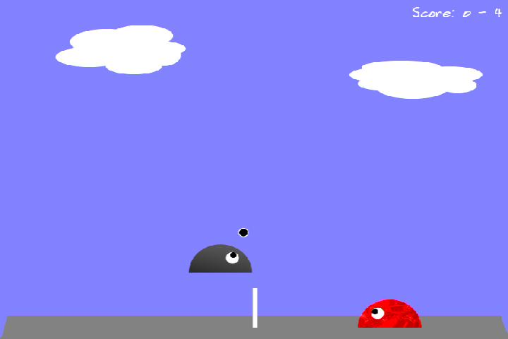
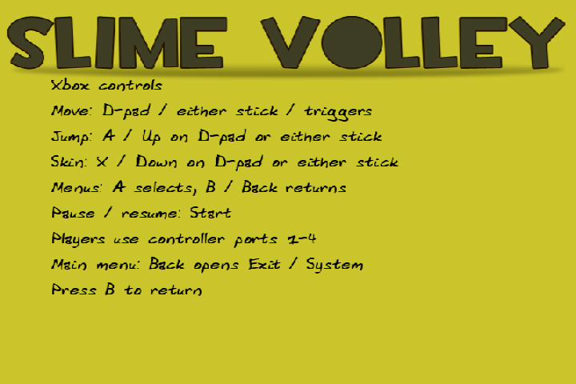

# Slime Volley — nxdk Xbox port

Slime Volley for the original Xbox, built with [nxdk](https://github.com/XboxDev/nxdk).
This playable test port keeps the original game and surface renderer, with Xbox
controller input, console-specific menus, and up to four player slots.

## Download and install on Xbox

1. Open [Releases](https://github.com/ZacharyLeahan/slimevolley-nxdk/releases) and
   choose the newest **alpha pre-release**. These are testing builds, not a stable 1.0 release.
2. Download **`slimevolley-nxdk-test.zip`** and extract it on your computer.
3. Copy the **entire extracted folder's contents** into a game folder under your
   Xbox dashboard's homebrew directory, for example `F:\Homebrew\SlimeVolley\`.
   Use the drive and homebrew folder configured on your modded original Xbox.
4. Launch **`default.xbe`** from that folder using your dashboard. If needed, add
   the folder to the dashboard's homebrew/game scan paths.

Keep `default.xbe`, `data/`, and the other package files together. The XBE needs
those assets to run; copying only the executable is not enough. The source ZIP
and GitHub's automatic source-code downloads are for developers, not installation.
Read the selected release's notes for its tested hardware and known limitations.

## Gameplay



A live 1v1 rally in the Modern theme, captured on original Xbox hardware
through [ESP-KVM for the Original Xbox](https://github.com/ZacharyLeahan/espkvm-xbox).
The original themes, skins, AI, speed modes, and multiball options are retained.
Play one-on-one or two-on-two with local controllers and AI teammates/opponents.

## Xbox controls



Team setup uses **Controller 1–4** to identify the physical Xbox controller ports.
The Xbox menus show controller help instead of desktop keyboard bindings.
Both images are unedited hardware captures; [capture details](docs/screenshots/README.md).

| Action | Xbox controller |
| --- | --- |
| Move left / right | D-pad, either analog stick, LT / RT |
| Jump | A or Up on the D-pad / either stick |
| Change skin | X or Down on the D-pad / either stick |
| Select / go back | A / B or Back |
| Pause / resume | Start |
| Open Exit / System from the main menu | B or Back |

Opposing directions use **last pressed wins** across the D-pad, both sticks and
triggers. Hold RT to move right, then press LT to switch left immediately;
release LT while still holding RT to move right again. Controls held in the
same direction combine. Opposite inputs first detected together keep the previous
winning direction, or stay neutral if neither was already active.

**Exit / System** offers Return to launcher, Restart game, Reboot Xbox, and
Power off Xbox. The menu and each action confirmation start on **Cancel**.
Return to launcher currently targets
`E:\Dashboard\default.xbe`; see the [port documentation](ports/nxdk/README.md)
for dashboard compatibility details and the Back + Start recovery shortcut.

## Agent testing on real hardware

This port was developed and tested using my
[ESP-KVM Xbox fork](https://github.com/ZacharyLeahan/espkvm-xbox).
It provides the video/audio capture and controller input used for the agentic
testing loop: inspect the Xbox screen, send controller inputs, capture the
result, then use the observed behavior to guide the next test or code change.
The screenshots above were captured through that same KVM.

Game builds are deployed and read back over the Xbox dashboard's FTP service;
the KVM supplies the live console view and input. Together they let a coding
agent build, deploy, play, inspect, and iterate on the real Xbox.

## Build and test

The [XboxDev nxdk repository](https://github.com/XboxDev/nxdk) provides the
open-source Xbox development kit that makes this build possible, including the
compiler/toolchain integration and Xbox libraries. This port uses its SDL2,
image, font, and audio support to run the original game on the console.


```sh
ports/nxdk/tools/bootstrap-sdk.sh
ports/nxdk/tools/build.sh
python3 ports/nxdk/tools/package.py
```

The Xbox executable is written to `ports/nxdk/bin/default.xbe`, and the alpha
test package to `artifacts/slimevolley-nxdk-test.zip`. The SDK revision and local
patches are pinned; see [build and deployment instructions](ports/nxdk/README.md).

Hardware tests cover gameplay, scoring, pause/resume, the controller UI, and all
four system actions. Host regressions run under address and undefined-behavior
sanitizers. A longer successful play session was also reported by the user.
This is a tested development port, with stock-64-MB hardware and four simultaneous
human controllers still outside the verified scope. See the
[hardware test report](ports/nxdk/TESTING.md) for exact build hashes and limitations.

The desktop build retains its original keyboard controls and six-player limit.

## Source and attribution

Slime Volley is by Côme Bernigaud (MCMic) and Vincent Duvert (VinDuv).
This repository preserves the available Debian-maintained Git history from
<https://salsa.debian.org/games-team/slimevolley>, starting from commit
`3548c5e` on its master branch. That repository includes the game's C/SDL source
and Debian packaging; it is not presented as the complete original development
history. The source repository remains configured as the `upstream` remote.

Original project: <https://slime.tuxfamily.org/>.
See [the original README](docs/README) for the existing game documentation.

## Licensing

Game code is GPL-3.0-or-later. Artwork, sounds, fonts, and packaging have their
own notices. Preserve these when modifying or distributing the game; see
[the detailed copyright and license notices](debian/copyright).

## Testing builds and releases

GitHub Actions builds downloadable Xbox testing packages containing `default.xbe`,
required assets, licenses and build metadata. Published downloads are on the
[Releases page](https://github.com/ZacharyLeahan/slimevolley-nxdk/releases).
Releases remain alpha pre-releases until testing establishes readiness. See [build downloads and release steps](ports/nxdk/RELEASING.md).
